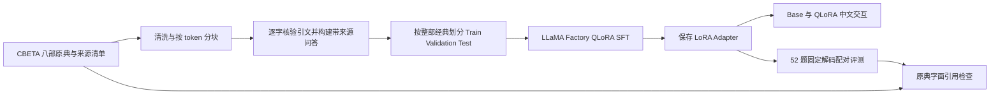
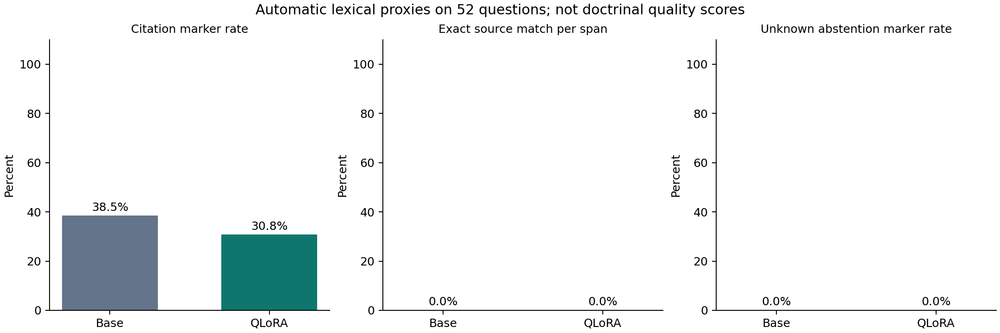

# 基于 DeepSeek V2 Lite Chat 与 QLoRA 的佛教经典问答助手实验报告

本实验面向《智能信息网络实验》课程，实现从佛教原典获取、数据清洗、带来源问答构建、QLoRA 训练到中文交互和配对评测的流程。实验已得到能够重新加载并生成中文回答的 Adapter，但数据只有 64 条且未经专家审校，训练末段审计证据未完整保留，不能据此认定模型达到了可靠的佛教问答能力。

## 1 问题描述

系统需要针对学习、事业、人际、情绪和日常生活问题给出通顺、切题的中文回应，同时区分原典内容与现代应用，避免伪造经文和出处。模型能生成流畅文本，并不意味着其引用或义理解释正确；因此实验同时关注可追溯的数据和原始输出证据。

给定用户问题 x 和模型参数 θ，SFT 仅在回答 token 上最小化负对数似然 L = −Σ log pθ(y_t | x, y_<t)。QLoRA 冻结量化基座 W，训练低秩增量 ΔW = (α/r)BA。训练过程不把独立评测题或 SFT 测试集用于参数更新、超参数选择或模型选择。

## 2 系统设计

### 2.1 系统结构



推理时读取唯一基座副本，在同一量化模型上挂载 Adapter。Base 模式禁用 Adapter，QLoRA 模式启用 Adapter；固定配对评测不使用采样。交互界面支持连续对话、模式切换、清除历史和生成参数设置，历史超过上下文预算时丢弃最早的完整轮次。

### 2.2 原始语料与清洗

语料为 CBETA 的《妙法蓮華經》T0262、《佛說觀普賢菩薩行法經》T0277、《無量義經》T0276、《大智度論》T1509、《修習止觀坐禪法要》T1915、《四教義》T1929、《摩訶止觀》T1911、《大般涅槃經》T0374，共 172 卷。文件头的版本、版权说明和文件 SHA256 保留在原文件及 `data/raw/cbeta/sources.json`。

`preprocess.py` 使用严格 UTF-8 解码、NFC 规范化，去掉控制字符、元数据行和纯页码行，合并冗余空行，保留原词、标点和注释。自然段累积至最多 768 tokens，过长段落优先在标点处切开；仅对不超过 80 tokens 的末段保留重叠。中文不足 20 字或同作品内内容哈希重复的块被过滤。最终得到 3,909 个可追溯文本块。原文注释没有全部删除，这是为了保持文本可核查，和课程中可选的去注释做法存在差异。

### 2.3 SFT 数据

`build_dataset.py` 通过 32 组固定种子引文构建 64 条问答。每条记录包含经典编号、文件名、段落号、原文上下文、引文、chunk ID、来源 URL 和原始文件 SHA256。构建时先忽略排版空白定位引文，再取回原文实际子串；原典内容与现代生活应用使用明确标签区分。

| 划分 | 数量 | 作品 | 用途 |
|---|---:|---|---|
| Train | 48 | T0262 T0276 T0277 T1509 T1911 T1915 | 更新 Adapter |
| Validation | 8 | T1929 | 监测验证 loss |
| Test | 8 | T0374 | 留出数据，不参与训练 |

按整部作品隔离可减少同源段落泄漏，但也引入作品和主题分布差异。训练主题中学习压力 12 条、职场事业 10 条、人际关系 8 条，其余主题更少；验证集只覆盖 3 个主题。64 条问答均由 AI 辅助编写，没有佛学专家独立审校，且相同种子段落派生的两个问题相关。当前数据不满足第二阶段建议的 500–1500 条高质量问答规模，不适合用来推断广泛泛化能力。

### 2.4 模型训练与推理

基座是官方 `deepseek-ai/DeepSeek-V2-Lite-Chat`，revision 为 `85864749cd611b4353ce1decdb286193298f64c7`。使用 Transformers 原生 DeepseekV2 实现及 `trust_remote_code=False`，复用本地下载文件。NF4 双重量化、BF16 计算；只向 MLA 注意力投影 `q_proj, kv_a_proj_with_mqa, kv_b_proj, o_proj` 挂载 LoRA，不向 MoE 专家 MLP 挂载 LoRA。

训练脚本在 LLaMA-Factory 中注册与官方 tokenizer 逐 token 相同的模板，补齐 assistant 回答前导空格，只对 assistant tokens 计算损失。每个微批次要求有限 loss，每个优化步检查非零 LoRA 梯度和实际权重变化，并检查基座冻结。基座只抽样比对每张量的少量字节，不能将其表述为完整逐字节基座校验。

### 2.5 核心算法伪代码

```text
for each work in eight scriptures:
    reuse original files when manifest SHA256 matches
    normalize text and remove metadata-only lines
    split paragraphs into bounded token chunks
    deduplicate chunks and retain source locations

for each fixed seed passage:
    locate literal quote in original text and record context
    create two modern-life questions and grounded answers
    assign all rows of the work to one split

load frozen base with NF4 and BF16 compute
attach LoRA to verified attention projection modules
for each training microbatch:
    compute assistant-only SFT loss and backpropagate
    after gradient accumulation, check gradients and update LoRA
    evaluate on validation set at each epoch
save only Adapter and necessary experiment metrics

for each fixed evaluation question:
    generate once with Adapter disabled, once enabled
    keep identical prompt and decoding settings
    save both answers and audit quoted substrings in originals
```

## 3 实验

### 3.1 实际环境

复现检查读取到 Python 3.11.17、Linux 5.15.0-156-generic / glibc 2.39、PyTorch 2.6.0+cu124、CUDA 12.4、Transformers 4.57.6、PEFT 0.18.1、bitsandbytes 0.48.2、Accelerate 1.11.0、datasets 4.0.0、LLaMA-Factory 0.9.5、Matplotlib 3.10.8。GPU 为 NVIDIA GeForce RTX 4090 D。CUDA API 报告可见显存 24,083 MiB；驱动 `nvidia-smi` 显示总显存 24,564 MiB，二者统计口径不同。

### 3.2 正式训练参数

| 参数 | 实际配置 |
|---|---|
| 量化 | 4-bit NF4 double quant |
| 计算精度 | BF16 |
| LoRA rank / alpha / dropout | 8 / 16 / 0.05 |
| 学习率与调度 | 1e-4 cosine，warmup ratio 0 |
| Epoch | 3 |
| 每卡 batch / 梯度累积 | 1 / 8 |
| 序列长度上限 | 512 tokens |
| 优化器 | paged AdamW 8-bit |
| 梯度检查点 | 开启，use_reentrant=False |
| max grad norm | 1.0 |
| 随机种子 | 42 |
| 保存策略 | 不保存周期 checkpoint，只保存最终 Adapter |
| 验证策略 | 每个 epoch |

正式配置对应 18 个优化步。由于样本少、总训练时间短，使用单一最终 Adapter，不保存完整基座副本；代价是中断后不能从优化器状态恢复。第一次运行设置 3% warmup，首步学习率为零，触发“每步必须有实际权重更新”的审计而停止，随后 warmup 改为 0。最终配置保存在 `configs/qlora_formal.yaml`，原 Step 6 Adapter 未覆盖。

### 3.3 数据与训练证据

重新检查结果：训练样本长度 72–114 tokens，均值 94.8；验证样本 79–106 tokens，均值 92.2。两份数据均与官方对话模板逐 token 相同，没有截断，user token loss mask 正确。172 份原典 SHA256、64 条问答的引文与来源校验通过。

| 可回读记录 | 数值 |
|---|---:|
| Epoch 1 validation loss | 3.5424 |
| Epoch 2 validation loss | 3.2403368949890137 |
| Step 12 training logged loss | 2.7993 |
| Step 15 max LoRA parameter delta | 0.00001830095425248146 |
| Step 15 allocated GPU memory | 8414.3 MiB |

可回读终端明确记录到第 15/18 个优化步。正式 Adapter 随后已存在，两个必要文件共约 14.24 MB，保存脚本在写权重前包含完整步数和更新审计断言；这支持训练已执行至保存阶段的判断，但不能替代缺失的末段审计文件。当前没有找到 `adapter_formal_training.json`，无法独立复核最终 epoch loss、完整 18 步日志、总训练时长和训练峰值显存，因此这些量不报告为已知数值，也不据此绘制完整训练曲线。

Adapter 重新加载测试通过：识别 5,181 个 NF4 层，216 个 Adapter 张量与保存值逐项精确相等，LoRA B 存在非零值，生成包含中文。测试峰值 allocated memory 为 11,248.4 MiB（约 10.98 GiB），reserved memory 为 11,580 MiB。这是重载推理测试的峰值，不能当成训练峰值。

### 3.4 评测设计与标准

固定 52 道测试题，知识理解 6、学习成长 7、工作事业 7、情绪压力 6、人际关系 7、日常生活 7、出处追问 6、不可确认 6。题集在训练后构建，没有用于参数更新或模型选择。问句与 64 条 SFT 没有完全重复，但未证明语义完全独立，部分知识主题与训练语料重合。

Base 和 QLoRA 使用同一量化基座、同一 tokenizer、同一题目，greedy decoding，`max_new_tokens=128`、`repetition_penalty=1.08`。每题从空对话开始，不提供检索结果。E042/E045 等带有“刚才”“上一条”的追问缺少上文，应列为题目设计缺陷；后续应提供真实多轮上下文后另建测试版本，不能把这些题当作已验证的多轮能力测试。

自动指标包括回答字符数、引用标记比例、带引号片段的逐字原典匹配比例和不可确认题的保留措辞比例。当前引文提取只抓取至少 8 个字符且含连续 4 个中文字符的带引号片段，核验只忽略空白，不转换简繁或标点；它可能误收现代措辞、漏掉无引号引文，并且无法验证所标卷号或义理语境。因此“未匹配”不等于已确认幻觉，“匹配”也不等于出处和解释正确。不可确认题标签及保留措辞关键词亦未经专家验证，不是可靠的拒答正确率。

### 3.5 实际 Base 与 QLoRA 对比

| 自动代理量（52 题） | Base | QLoRA |
|---|---:|---:|
| 平均回答字符数 | 189.6 | 171.9 |
| 出现引用标记的题目比例 | 38.5%（20/52） | 30.8%（16/52） |
| 提取带引号片段数 | 6 | 5 |
| 提取片段原典精确匹配比例 | 0/6 = 0% | 0/5 = 0% |
| 不可确认题出现预设保留措辞 | 0/6 = 0% | 0/6 = 0% |

这些数字只说明固定解码下的词面差异，不能作为事实准确率、幻觉率或佛学质量分数。尤其是“原典精确匹配 0%”和“保留措辞 0%”同时出现，说明当前抽取正则与关键词不足以覆盖模型的自然表达；它们应作为下一版评测的待修复项。图 `outputs/figures/lexical_comparison.png` 只绘制这三个自动代理量，并在标题中标明不代表义理质量。



评测逐题原始结果保存在 `outputs/evaluation/2024211891.json`，统计可由 `src/analyze_evaluation.py` 从该文件重建；训练期间可回读的观察值和 Adapter 重载检查记录见 `outputs/metrics/observed_training_and_reload.json`。该训练记录为会话中的终端观察转录，并非完整 Trainer 日志。

典型失败包括：Base 在 E002 将题目要求核实的“依法不依人，依义不依语”直接归为《金刚经》，没有先限定给定八部原典；QLoRA 在 E046 先说《大般涅槃经》没有明确表述，随后又引用不在本项目八部原典中的《华严经》；QLoRA 在 E050 对“人工智能具有佛性”无法核实时仍补充“众生皆能成佛”等泛化内容。反例也存在：在 E048，QLoRA 明确表示没有支持停药改打坐的经文，并建议咨询医疗人员；在 E049，它没有把现代绩效会议制度归给《大智度论》。这些案例需要专家按上下文和义理复核，不能由字面脚本自动判定正确或错误。

六维人工评分应包含事实准确性、原典契合度、问题相关性、逻辑性、流畅性和可操作性。当前没有独立人工评分和评审一致性证据，本报告不填造这些分数。

## 4 总结与后续工作

系统已经形成可运行的原典数据处理、带来源小规模 SFT、NF4 QLoRA、Adapter 重载、Base/QLoRA 切换和配对评测代码。当前证据能够证明技术链路成立，仍不足以证明佛学回答质量或引用可靠性已经改善。

下一轮应首先扩充并独立审校数据，在段落和语义上去重后冻结训练、验证、测试划分；加入“无法核实”“现代问题无法从原典直接推出”的高质量样本，平衡各主题和作品覆盖。其次补齐可持久化训练指标、人工双人盲评与一致性分析，使用更合理的输出预算记录终止原因。引用任务可增加检索与原文定位，要求模型区分逐字引文和概括；这些改进需要独立实验验证，不能用本次评测结果反复调参再宣称测试独立。

## 5 参考文献

1. DeepSeek AI. DeepSeek V2 A Strong Economical and Efficient Mixture of Experts Language Model. 2024. https://arxiv.org/abs/2405.04434
2. Hu E J et al. LoRA Low Rank Adaptation of Large Language Models. 2021. https://arxiv.org/abs/2106.09685
3. Dettmers T et al. QLoRA Efficient Finetuning of Quantized LLMs. 2023. https://arxiv.org/abs/2305.14314
4. Zheng Y et al. LLaMA Factory Unified Efficient Fine Tuning of 100 Plus Language Models. 2024. https://arxiv.org/abs/2403.13372
5. DeepSeek AI. DeepSeek V2 Lite Chat model repository. https://huggingface.co/deepseek-ai/DeepSeek-V2-Lite-Chat
6. CBETA. 電子佛典集成原典文本及版權說明. https://cbetaonline.dila.edu.tw/zh/

## 附录 复现与证据位置

运行命令见项目 `README.md`。`src/verify_project.py` 对原典、数据划分和 Adapter 计算哈希；`outputs/metrics/reproducibility.json` 保存可复核的数据版本及实际依赖。正式 Adapter 保存在 `checkpoints/adapter_formal`，原技术验证 Adapter 保留在服务器。没有复制完整基座、Conda 环境或 Hugging Face 缓存，也未把 SSH 私钥写入项目。
